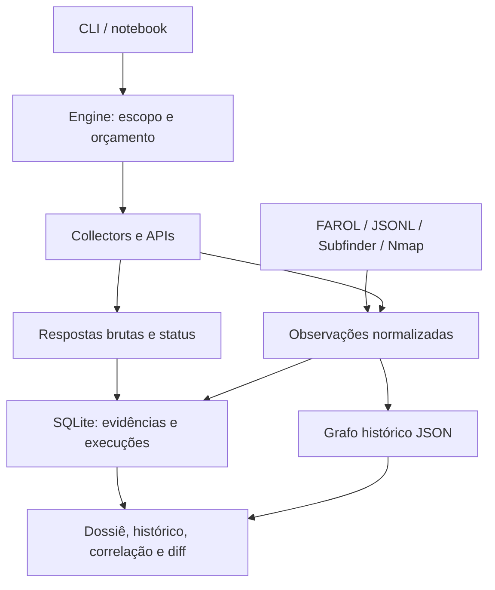

<div align="center">

# 🔺 VÉRTICE

**Attack Surface Mapping & Intelligence Gathering · v2.0**

Cada ativo, uma origem. Cada relação, uma evidência.

[](https://colab.research.google.com/github/Ridd1kulusC0d3r/VeRTICE/blob/main/notebooks/VeRTICE_Colab.ipynb)
[](https://github.com/Ridd1kulusC0d3r/VeRTICE/actions/workflows/tests.yml)

**OSINT · grafo de vínculos · evidências SHA-256 · inteligência de superfície · comparação temporal · preparação de pentest**

Python 3.9+ · sem dependências de runtime · família DEIVOSINT

</div>

> **v2.0** — 15 collectors (novos: InternetDB, ASN/RIPEstat, SPF/DMARC, TLS cert,
> dorks), integração **FAROL** ("dentro do host"), confiança por corroboração,
> **diff de superfície**, correlação de ativos e exportação **STIX / nmap / httpx**.
> Compatível com workspaces v1. Histórico em [CHANGELOG.md](CHANGELOG.md).

## Testar agora, pelo navegador

1. **[Abra o laboratório Colab](https://colab.research.google.com/github/Ridd1kulusC0d3r/VeRTICE/blob/main/notebooks/VeRTICE_Colab.ipynb).**
2. Selecione **Ambiente de execução → Executar tudo**.
3. Explore o dossiê no notebook, compare duas execuções simuladas e baixe o ZIP.

Não exige GPU, chave de API ou túnel externo. A demonstração é offline e sintética,
com domínios `.example`/IPs de documentação. A instalação inicial requer internet.
A célula final oferece coleta real opcional, desativada por padrão.

## De onde o VÉRTICE nasceu (engenharia reversa)

Reimplementamos o padrão essencial de **16 referências** e as unimos num produto
passivo por padrão e sem licença. Detalhe em [docs/ENGENHARIA-REVERSA.md](docs/ENGENHARIA-REVERSA.md).

| Padrão herdado | De onde | Onde vive no VÉRTICE |
|---|---|---|
| Pivô (tipo → N consultas) | Mitaka, FOFA | `pivots/registry.py` |
| Grafo de entidades tipadas | Maltego, Amass | `core/graph.py` |
| Agregação multi-fonte com proveniência | Sublist3r, Subfinder | `core/engine.py` |
| Engine + fronteira passivo/ativo | Amass | `core/engine.py` |
| Fingerprint passivo de tecnologia | BuiltWith | `collectors/web_fingerprint.py` |
| Workspace + banco por engajamento | Recon-ng | `core/workspace.py` |
| Índice de ciberespaço (cert/favicon/serviço) | ZoomEye, FOFA, Censys | `collectors/crtsh.py`, `collectors/cyberspace.py` |
| Vulnerabilidade passiva (porta/CVE sem chave) | Shodan InternetDB | `collectors/internetdb.py` |
| ASN/netblock sem chave | RIPEstat | `collectors/asn_bgp.py` |
| Superfície interna (endpoints/segredos) | Photon → **FAROL** | `importers/farol.py` |
| **Custódia criptográfica de evidência** | — (inovação) | `core/evidence.py` |
| **Inteligência sobre o grafo** (confiança/diff/correlação) | — (inovação) | `core/intel.py` |

## O que você recebe

| Capacidade | Implementação atual |
|---|---|
| Descoberta | crt.sh, DNS via DoH, RDAP, Wayback, InternetDB (porta/CVE), ASN/RIPEstat |
| Postura | SPF/DMARC (`emailsec`), certificado TLS (`tlscert`), dorks Google/Bing/GitHub |
| Índices de infraestrutura | Adaptadores opcionais Shodan/Censys/ZoomEye/FOFA; dependem de API/plano |
| Fingerprint | Requisições diretas, somente com `--active` e escopo explícito |
| Integração offline | FAROL JSONL, JSONL genérico (F.I.O./GARIMPO/PRISMA), Subfinder JSONL, Nmap XML |
| Investigação | Grafo tipado, fontes, evidências consultáveis, pivôs manuais |
| Inteligência | Confiança por corroboração, correlação de ativos, diff de superfície |
| Histórico | ID por execução, status, duração por tarefa, observações e comparação |
| Integridade | SQLite com hashes SHA-256 encadeados e escrita serializada |
| Saídas | Dossiê HTML, grafo SVG, exportação jsonl/csv/STIX/targets/nmap/httpx |
| Apresentação | Bancada web local e relatório HTML sem CDN |

**Não é um scanner de vulnerabilidades, prova automática de propriedade ou validação de exploração.**
Os adaptadores proprietários não foram validados ao vivo com credenciais nesta versão;
a existência de código não garante disponibilidade da API. Os pivôs são links de pesquisa,
não integrações executáveis.

## Instalação e primeiro caso

```bash
git clone https://github.com/Ridd1kulusC0d3r/VeRTICE.git
cd VeRTICE
python -m vertice demo demo-vertice
python -m vertice report demo-vertice
python -m vertice bench demo-vertice     # http://127.0.0.1:8713
```

Também dá para instalar a CLI com `python -m pip install .`.

Para um domínio real **autorizado**:

```bash
python -m vertice init caso --scope seu-dominio.com --by "Referência do engajamento"
python -m vertice collectors
python -m vertice run caso --seed seu-dominio.com --collectors crtsh,dns,rdap,internetdb,asn --depth 2 --max-tasks 50
python -m vertice report caso
python -m vertice verify caso
```

O modo padrão não solicita páginas diretamente ao alvo. DNS via resolvedor pode
provocar consultas autoritativas e não implica invisibilidade. Resultados fora do
escopo ficam como evidência, mas não são expandidos quando há escopo. Um IP
descoberto por DNS **não herda** a autorização do domínio.

```bash
# Coleta direta explicitamente habilitada; redirects não são seguidos.
python -m vertice run caso --seed seu-dominio.com --active --collectors fingerprint,tlscert
```

Escopo vazio bloqueia coleta ativa. Aceita domínios/subdomínios, IPs e CIDRs.
Profundidade de 1 a 5; teto padrão de 200 tarefas por execução.

## Inteligência e saídas (v2)

```bash
# superfície priorizada → formatos para a próxima fase / plataforma CTI
python -m vertice export caso --format stix  -o caso.stix.json
python -m vertice export caso --format nmap  -o alvos.txt    # nmap -iL alvos.txt
python -m vertice export caso --format httpx -o urls.txt     # httpx -l urls.txt
python -m vertice export caso --format csv                   # ou jsonl / targets

# detecção de mudança na superfície (entre snapshots; 'run' snapshota sozinho)
python -m vertice snapshot caso --list
python -m vertice diff caso                  # compara os 2 últimos snapshots
```

## Importar resultados existentes

```bash
# FAROL ("dentro do host") e irmãs DEIVOSINT (JSONL)
python -m vertice import caso --farol farol.jsonl
python -m vertice import caso --jsonl fio.jsonl --source fio

# saída de scanners, sem executá-los
python -m vertice ingest caso --format subfinder --file examples/subfinder.jsonl --domain aurora.example
python -m vertice ingest caso --format nmap --file examples/nmap.xml
```

Importações preservam o arquivo bruto e seu hash, sem executar scanners nem
autorizar os ativos importados. **Segredos vindos do FAROL são redigidos**: guarda-se
só o rótulo (`segredo:<tipo>@<host>`), nunca o valor. Limite por arquivo: 20 MiB.

## Comparar execuções (histórico)

```bash
python -m vertice runs caso
python -m vertice rundiff caso --before ID_ANTERIOR --after ID_ATUAL
```

A comparação mostra novas observações, atributos alterados e itens não reobservados.
**Não reobservado não significa removido.** O grafo é histórico e não representa
confirmação atual de disponibilidade. Cada tarefa distingue `success`, `empty`,
`partial` e `error`; credenciais ausentes são registradas como skips.

## Arquitetura de dados e software



- **Entidade:** identificador tipado; normalização e deduplicação do grafo.
- **Observação:** afirmação de uma fonte, vinculada à execução e à evidência.
- **Confiança:** cresce com o nº de fontes distintas (`seed` = 1.0).
- **Relação:** associação com `first_seen`, `last_seen` e hash da evidência recente.
- **Execução:** configuração, tarefas, erros, duração e estado de conclusão.
- **Dados brutos:** respostas HTTP limitadas a 4 MiB, base64 no ledger; query
  strings de credenciais conhecidas são redigidas.

## Integridade e interpretação

SHA-256 encadeado detecta adulteração interna, mas truncamento do final ou reescrita
integral exige comparar com um head preservado externamente. Não equivale a assinatura
digital nem a cadeia de custódia jurídica completa.

IP compartilhado, certificado ou favicon igual **não comprovam** propriedade. O hash
`vfav:` é próprio do VÉRTICE, não o MurmurHash usado por outros serviços. Tecnologia
identificada não confirma CVE. A pontuação é heurística de triagem explicada no relatório.

## Conectores com credenciais

| Adaptador | Nome local da credencial | Limitação |
|---|---|---|
| Shodan | `shodan_key` | Plano e permissões da API |
| Censys | `censys_token` (`ID:SECRET`) | Adaptador Search v2; validar a conta |
| ZoomEye | `zoomeye_key` | Endpoint/contrato precisam de validação ao vivo |
| FOFA | `fofa_key` (`email:key`) | Endpoint/contrato precisam de validação ao vivo |

As chaves ficam em `credentials.json` no workspace, fora do Git e do ZIP do Colab.

## Testes

```bash
python -m unittest discover -s tests -v
```

Veja [RELATORIO-TESTES.md](RELATORIO-TESTES.md). O notebook também é testado offline.

## Licença

O repositório ainda não possui licença de distribuição definida pelo autor.
Não presume permissões de reutilização dos produtos usados como referências.
