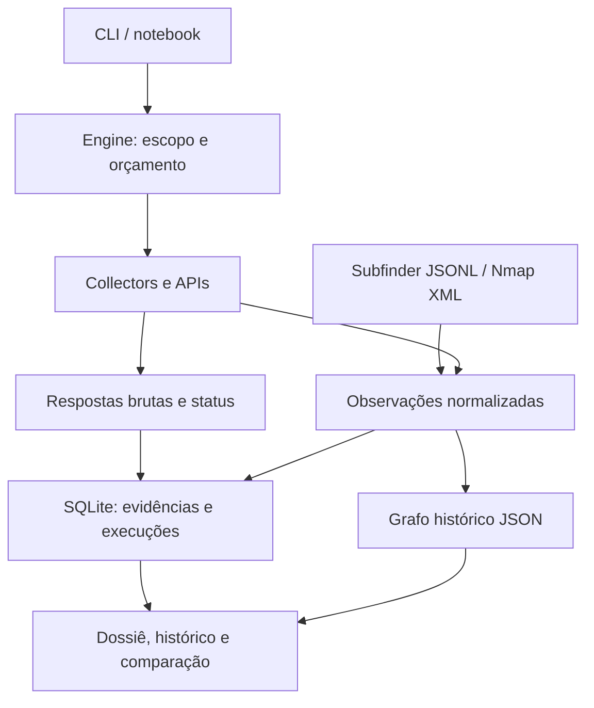

<div align="center">

# 🔺 VÉRTICE

**Attack Surface Mapping & Intelligence Gathering · v1.1**

Cada ativo, uma origem. Cada relação, uma evidência.

[](https://colab.research.google.com/github/Ridd1kulusC0d3r/VeRTICE/blob/main/notebooks/VeRTICE_Colab.ipynb)
[](https://github.com/Ridd1kulusC0d3r/VeRTICE/actions/workflows/tests.yml)

**OSINT · grafo de vínculos · evidências · comparação temporal · preparação de pentest**

Python 3.9+ · sem dependências de runtime · família DEIVOSINT

</div>

## Testar agora, pelo navegador

1. **[Abra o laboratório Colab](https://colab.research.google.com/github/Ridd1kulusC0d3r/VeRTICE/blob/main/notebooks/VeRTICE_Colab.ipynb).**
2. Selecione **Ambiente de execução → Executar tudo**.
3. Explore o dossiê dentro do notebook, compare duas execuções simuladas e baixe o ZIP pela barra Arquivos.

Não exige GPU, chave de API ou túnel externo. A demonstração é offline e sintética,
com domínios `.example` e IPs de documentação. A instalação inicial requer internet.
A célula final oferece coleta real opcional, desativada por padrão.

Se o iframe for bloqueado pelo navegador, o ZIP contém `dossie.html` autocontido.
O runtime do Colab é temporário: exporte antes de encerrar. O código e o servidor
foram testados localmente; a sessão autenticada e o proxy visual do Google Colab
não foram executados neste ambiente.

## O que você recebe

| Capacidade | Implementação atual |
|---|---|
| Descoberta | crt.sh, DNS via DoH, RDAP e Wayback |
| Índices de infraestrutura | Adaptadores opcionais de Shodan, Censys, ZoomEye e FOFA; dependem de API/plano |
| Fingerprint | Requisições diretas, somente com `--active` e escopo explícito |
| Integração offline | Importação Subfinder JSONL e Nmap XML; não executa os binários |
| Investigação | Grafo tipado, fontes, evidências consultáveis e pivôs manuais |
| Histórico | ID por execução, status, duração por tarefa, observações e comparação |
| Integridade | SQLite com hashes SHA-256 encadeados e escrita serializada |
| Apresentação | Bancada web local e relatório HTML sem CDN |

**Não é um scanner de vulnerabilidades, prova automática de propriedade ou validação de exploração.**
Os adaptadores proprietários não foram validados ao vivo com credenciais nesta versão;
a existência de código não garante disponibilidade da API. Os pivôs são links de pesquisa,
não integrações executáveis. Não há integração universal de todas as ferramentas das listas.

## Instalação e primeiro caso

```bash
git clone https://github.com/Ridd1kulusC0d3r/VeRTICE.git
cd VeRTICE
python -m vertice demo demo-vertice
python -m vertice report demo-vertice
python -m vertice bench demo-vertice
```

Abra `http://127.0.0.1:8713`. Também é possível instalar a CLI com `python -m pip install .`.

Para um domínio real autorizado, substitua o exemplo abaixo:

```bash
python -m vertice init caso --scope seu-dominio.com --by "Referência do engajamento"
python -m vertice collectors
python -m vertice run caso --seed seu-dominio.com --collectors crtsh,dns,rdap --depth 1 --max-tasks 10
python -m vertice report caso
python -m vertice verify caso
```

O modo padrão não solicita páginas diretamente ao alvo. DNS via resolvedor pode
provocar consultas autoritativas e não implica invisibilidade. Resultados fora do
escopo ficam como evidência, mas não são expandidos automaticamente quando há escopo.
Um IP descoberto por DNS **não herda** a autorização do domínio.

```bash
# Coleta direta explicitamente habilitada; redirects não são seguidos.
python -m vertice run caso --seed seu-dominio.com --active --collectors fingerprint
```

Escopo vazio bloqueia coleta ativa. São aceitos domínios/subdomínios, IPs e CIDRs.
A profundidade varia de 1 a 5; o teto padrão é 200 tarefas por execução.

## Comparar execuções

```bash
python -m vertice runs caso
python -m vertice diff caso --before ID_ANTERIOR --after ID_ATUAL
```

A comparação mostra novas observações, atributos alterados e itens não reobservados.
**Não reobservado não significa removido.** O grafo é histórico e não representa
uma confirmação atual de disponibilidade. `comparable` considera a configuração e
conclusão das execuções; não garante cobertura integral das fontes.

Cada tarefa distingue `success`, `empty`, `partial` e `error`. Credenciais ausentes
são registradas como skips. Execuções sem encerramento aparecem como `interrupted`.
Não existe retomada automática da fila nesta versão.

## Importar resultados existentes

```bash
python -m vertice init caso-import --scope aurora.example --by "Demonstração"
python -m vertice import caso-import --format subfinder --file examples/subfinder.jsonl --domain aurora.example
python -m vertice import caso-import --format nmap --file examples/nmap.xml
python -m vertice report caso-import
```

Os exemplos são sintéticos. As importações preservam o arquivo bruto e seu hash,
sem executar scanners ou autorizar os ativos importados. Nmap importa portas abertas;
Subfinder importa os hosts e a fonte declarada no JSONL. Limite por arquivo: 20 MiB.

## Arquitetura de dados e software



- **Entidade:** identificador tipado; normalização e deduplicação do grafo.
- **Observação:** afirmação de uma fonte, vinculada à execução e à evidência.
- **Relação:** associação com `first_seen`, `last_seen` e hash da evidência mais recente.
- **Execução:** configuração, tarefas, erros, duração e estado de conclusão.
- **Tempo:** `collected_at` é o momento da coleta; `observed_at` só é preenchido quando a fonte fornece a data. Caso contrário permanece desconhecido.
- **Dados brutos:** respostas HTTP limitadas a 4 MiB, armazenadas em base64 no ledger. Truncamento torna a tarefa incompleta. Query strings de credenciais conhecidas são redigidas.

O relatório permite inspecionar as últimas 100 observações. O ledger preserva o histórico
completo. Fontes que repetem a mesma informação não são tratadas como confirmações independentes.
A normalização de domínio registrável ainda usa heurística, sem Public Suffix List.

## Integridade e interpretação

SHA-256 encadeado detecta adulteração interna, mas truncamento do final ou reescrita
integral exige comparar com um head preservado externamente. Isso não equivale a
assinatura digital, carimbo de tempo confiável ou cadeia de custódia jurídica completa.

IP compartilhado, certificado ou favicon igual não comprovam propriedade. O hash
`vfav:` é próprio do VÉRTICE, não é o MurmurHash usado por outros serviços. Tecnologia
identificada não confirma CVE. A pontuação é uma heurística de triagem explicada no relatório.

## Conectores com credenciais

| Adaptador | Nome local da credencial | Limitação |
|---|---|---|
| Shodan | `shodan_key` | Plano e permissões da API |
| Censys | `censys_token` (`ID:SECRET`) | Adaptador legado Search v2; validar compatibilidade da conta |
| ZoomEye | `zoomeye_key` | Endpoint e contrato precisam de validação ao vivo |
| FOFA | `fofa_key` (`email:key`) | Endpoint e contrato precisam de validação ao vivo |

As chaves ficam em `credentials.json` no workspace, fora do Git e do ZIP do Colab.
Use credenciais somente em runtime privado. Respostas coletadas podem conter dados sensíveis;
revise o conteúdo antes de compartilhar um pacote real.

## Testes e evolução

```bash
python -m unittest discover -s tests -v
```

Veja [RELATORIO-TESTES.md](RELATORIO-TESTES.md) e [a arquitetura/evolução](docs/ARQUITETURA.md).
O notebook também é testado offline, incluindo comparação, servidor HTTP e exportação.

Próximas etapas: fila durável com retomada, banco PostgreSQL para múltiplos usuários,
armazenamento de objetos, políticas de retenção, tratamento de conflitos entre fontes,
validação dos conectores comerciais e resolução de entidades mais rigorosa.

## Licença

O repositório ainda não possui licença de distribuição definida pelo autor.
Não presume permissões de reutilização dos produtos usados como referências.
